# Meeting Management System Documentation

## Table of Contents
1. [Overview](#overview)
2. [Features](#features)
3. [Architecture](#architecture)
4. [API Endpoints](#api-endpoints)
5. [Database Schema](#database-schema)
6. [Frontend Components](#frontend-components)
7. [User Roles & Permissions](#user-roles--permissions)
8. [Workflow](#workflow)
9. [Configuration](#configuration)
10. [Troubleshooting](#troubleshooting)

## Overview

The Meeting Management System is a comprehensive solution for scheduling, managing, and tracking meetings between supervisors and students in the Project Phoenix application. It provides real-time collaboration features, conflict detection, and team-based meeting management.

### Key Capabilities
- **Smart Scheduling**: Automated conflict detection and availability checking
- **Team Collaboration**: All team members can view and manage meetings
- **Role-based Access**: Different permissions for supervisors, students, and admins
- **Real-time Updates**: Live calendar updates and notifications
- **Audit Trail**: Complete history tracking of all meeting changes
- **Task Management**: Action items and follow-up tasks

## Features

### 1. Meeting Scheduling
- **Custom Time Requests**: Students can request specific meeting times
- **Availability Checking**: Automatic conflict detection with existing meetings
- **Multiple Meeting Types**: Support for different meeting categories (proposal, mid-term, final, etc.)
- **Duration Management**: Configurable meeting durations
- **Location Support**: Physical and virtual meeting locations

### 2. Meeting Management
- **Edit Meetings**: Update meeting details, time, location, and type
- **Delete Meetings**: Remove meetings with proper authorization
- **Status Tracking**: Monitor meeting status (scheduled, completed, cancelled)
- **Approval Workflow**: Supervisors can approve/reject meeting requests

### 3. Team Collaboration
- **Shared Visibility**: All team members can see team meetings
- **Collective Management**: Any team member can edit/delete team meetings
- **Project Integration**: Meetings are linked to specific projects
- **Member Notifications**: Automatic notifications for all team members

### 4. Calendar Integration
- **Interactive Calendar**: Visual calendar with meeting display
- **Month Navigation**: Easy month-to-month navigation
- **Meeting Details**: Quick access to meeting information
- **Responsive Design**: Works on desktop and mobile devices

### 5. Audit & History
- **Change Tracking**: Complete history of all meeting modifications
- **Action Logging**: Who made changes and when
- **Details Recording**: Specific details about each change
- **Role Tracking**: Track which role performed each action

## Architecture

### System Overview
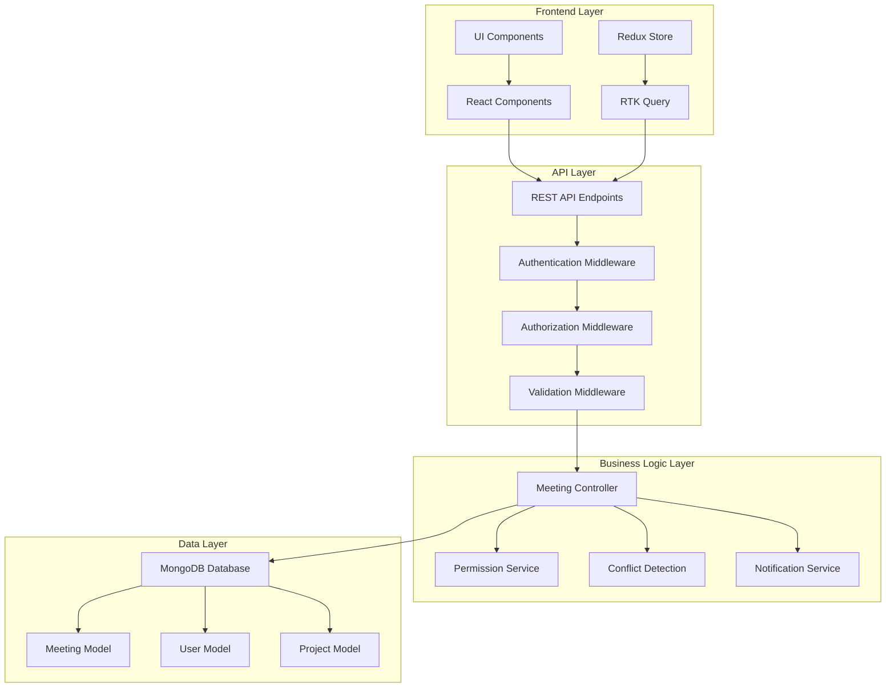

### Backend Architecture
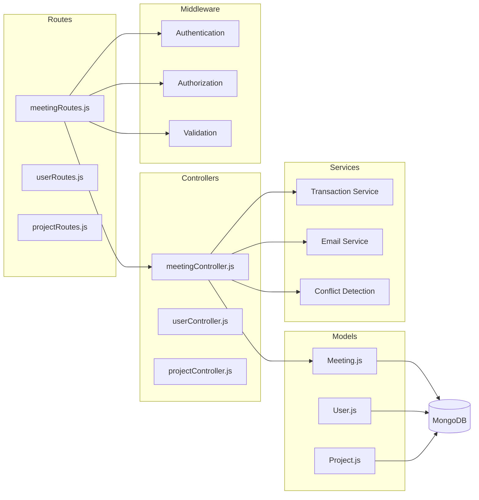

### Frontend Architecture
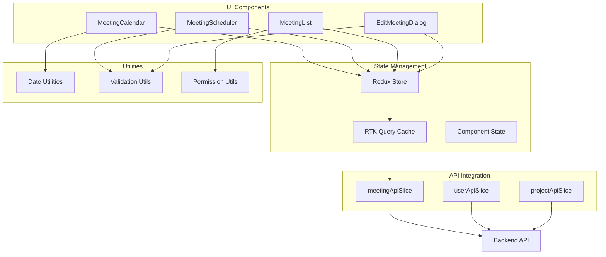

### Data Flow Architecture
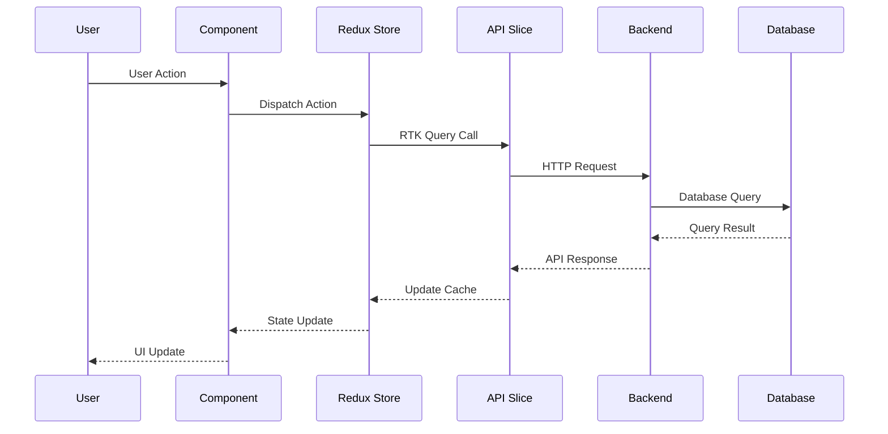

## API Endpoints

### Meeting Management Endpoints

#### 1. Create Meeting
```http
POST /api/meetings
Authorization: Bearer <token>
Content-Type: application/json

{
  "supervisorId": "64f1a2b3c4d5e6f7g8h9i0j1",
  "projectId": "64f1a2b3c4d5e6f7g8h9i0j2",
  "scheduledDate": "2024-09-15T10:00:00.000Z",
  "duration": 60,
  "meetingType": "proposal",
  "location": "Room 101",
  "description": "Project proposal discussion"
}
```

#### 2. Get Available Slots
```http
GET /api/meetings/available-slots?supervisorId=64f1a2b3c4d5e6f7g8h9i0j1&projectId=64f1a2b3c4d5e6f7g8h9i0j2&date=2024-09-15&duration=60
Authorization: Bearer <token>
```

#### 3. Update Meeting
```http
PUT /api/meetings/:id
Authorization: Bearer <token>
Content-Type: application/json

{
  "scheduledDate": "2024-09-15T11:00:00.000Z",
  "duration": 90,
  "meetingType": "mid-term",
  "location": "Virtual Meeting",
  "description": "Updated meeting details"
}
```

#### 4. Delete Meeting
```http
DELETE /api/meetings/:id
Authorization: Bearer <token>
```

#### 5. Get Meetings
```http
GET /api/meetings?projectId=64f1a2b3c4d5e6f7g8h9i0j2&status=scheduled
Authorization: Bearer <token>
```

#### 6. Approve/Reject Meeting Request
```http
POST /api/meetings/:id/request
Authorization: Bearer <token>
Content-Type: application/json

{
  "action": "approve", // or "reject"
  "comments": "Meeting approved for the requested time"
}
```

### Response Formats

#### Success Response
```json
{
  "status": "success",
  "message": "Meeting created successfully",
  "data": {
    "meeting": {
      "_id": "64f1a2b3c4d5e6f7g8h9i0j3",
      "supervisor": "64f1a2b3c4d5e6f7g8h9i0j1",
      "student": ["64f1a2b3c4d5e6f7g8h9i0j4"],
      "projectId": "64f1a2b3c4d5e6f7g8h9i0j2",
      "scheduledDate": "2024-09-15T10:00:00.000Z",
      "duration": 60,
      "meetingType": "proposal",
      "location": "Room 101",
      "status": "scheduled",
      "history": [...],
      "actionItems": [...]
    }
  }
}
```

#### Error Response
```json
{
  "status": "error",
  "message": "Meeting conflict detected",
  "error": {
    "code": "CONFLICT_ERROR",
    "details": "Time slot already occupied"
  }
}
```

## Database Schema

### Meeting Model
```javascript
const meetingSchema = new Schema({
  supervisor: {
    type: Schema.Types.ObjectId,
    ref: 'Supervisor',
    required: true
  },
  student: [{
    type: Schema.Types.ObjectId,
    ref: 'Student',
    required: true
  }],
  projectId: {
    type: Schema.Types.ObjectId,
    ref: 'Project',
    required: true
  },
  scheduledDate: {
    type: Date,
    required: true
  },
  duration: {
    type: Number,
    required: true,
    default: 60
  },
  meetingType: {
    type: String,
    enum: ['proposal', 'mid-term', 'final', 'progress', 'other'],
    required: true
  },
  location: {
    type: String,
    required: true
  },
  description: {
    type: String,
    default: ''
  },
  status: {
    type: String,
    enum: ['scheduled', 'completed', 'cancelled', 'rescheduled'],
    default: 'scheduled'
  },
  meetingRequest: {
    requestedBy: {
      type: Schema.Types.ObjectId,
      ref: 'Student'
    },
    requestedAt: Date,
    status: {
      type: String,
      enum: ['pending', 'approved', 'rejected'],
      default: 'pending'
    },
    supervisorComments: String,
    respondedAt: Date
  },
  actionItems: [{
    item: {
      type: String,
      required: true
    },
    assignedTo: {
      type: Schema.Types.ObjectId,
      ref: 'Student'
    },
    dueDate: Date,
    status: {
      type: String,
      enum: ['pending', 'in-progress', 'completed'],
      default: 'pending'
    },
    priority: {
      type: String,
      enum: ['low', 'medium', 'high'],
      default: 'medium'
    },
    createdAt: {
      type: Date,
      default: Date.now
    }
  }],
  history: [{
    action: {
      type: String,
      enum: ['created', 'rescheduled', 'cancelled', 'completed', 'notes_updated'],
      required: true
    },
    performedBy: {
      type: Schema.Types.ObjectId,
      refPath: 'history.performedByModel'
    },
    performedByModel: {
      type: String,
      enum: ['Student', 'Supervisor', 'Admin']
    },
    details: String,
    timestamp: {
      type: Date,
      default: Date.now
    }
  }]
}, {
  timestamps: true
});
```

### Indexes
```javascript
// Compound indexes for efficient queries
meetingSchema.index({ supervisor: 1, scheduledDate: 1 });
meetingSchema.index({ student: 1, scheduledDate: 1 });
meetingSchema.index({ projectId: 1, scheduledDate: 1 });
meetingSchema.index({ status: 1, scheduledDate: 1 });
```

## Frontend Components

### 1. MeetingCalendar Component
**Purpose**: Displays meetings in a calendar format
**Features**:
- Month navigation
- Meeting display with status indicators
- Edit/Delete functionality
- Responsive design

**Props**:
```javascript
{
  meetings: Array,
  onEditMeeting: Function,
  onDeleteMeeting: Function,
  userRole: String,
  isLoading: Boolean
}
```

### 2. MeetingScheduler Component
**Purpose**: Form for creating new meetings
**Features**:
- Meeting type selection
- Date/time picker
- Location input
- Description field
- Validation

**Props**:
```javascript
{
  onSubmit: Function,
  isLoading: Boolean,
  supervisorId: String,
  projectId: String
}
```

### 3. MeetingList Component
**Purpose**: List view of meetings
**Features**:
- Sortable columns
- Filter options
- Pagination
- Bulk actions

**Props**:
```javascript
{
  meetings: Array,
  onEditMeeting: Function,
  onDeleteMeeting: Function,
  userRole: String
}
```

### 4. EditMeetingDialog Component
**Purpose**: Modal for editing meeting details
**Features**:
- Pre-populated form
- Validation
- Save/Cancel actions
- Real-time updates

**Props**:
```javascript
{
  meeting: Object,
  isOpen: Boolean,
  onClose: Function,
  onSave: Function,
  isLoading: Boolean
}
```

## User Roles & Permissions

### User Journey Diagram
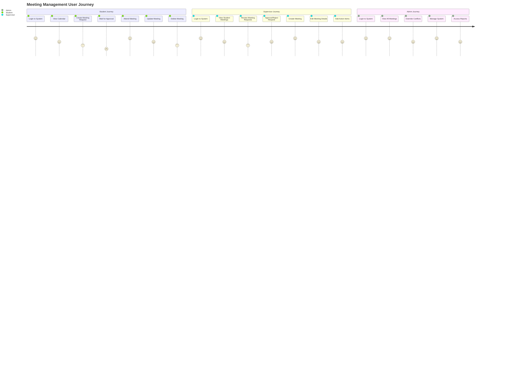

### Permission Matrix
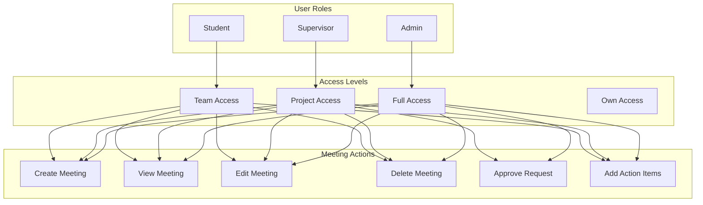

### Supervisor Permissions
- ✅ Create meetings for their students
- ✅ Edit any meeting they're supervising
- ✅ Delete meetings they're supervising
- ✅ Approve/reject meeting requests
- ✅ View all meetings for their students
- ✅ Add action items to meetings

### Student Permissions
- ✅ Create meetings with their supervisor
- ✅ Edit meetings they're part of (team-based)
- ✅ Delete meetings they're part of (team-based)
- ✅ View all team meetings
- ✅ Request custom meeting times
- ✅ Respond to meeting requests

### Admin Permissions
- ✅ Full access to all meetings
- ✅ Edit/delete any meeting
- ✅ Override meeting conflicts
- ✅ Access to all meeting data
- ✅ System configuration

### Team-Based Permissions
- **Shared Visibility**: All team members can see team meetings
- **Collective Management**: Any team member can edit/delete team meetings
- **Project Integration**: Meetings are linked to project teams
- **Automatic Inclusion**: New meetings include all team members

## Workflow

### 1. Meeting Creation Workflow
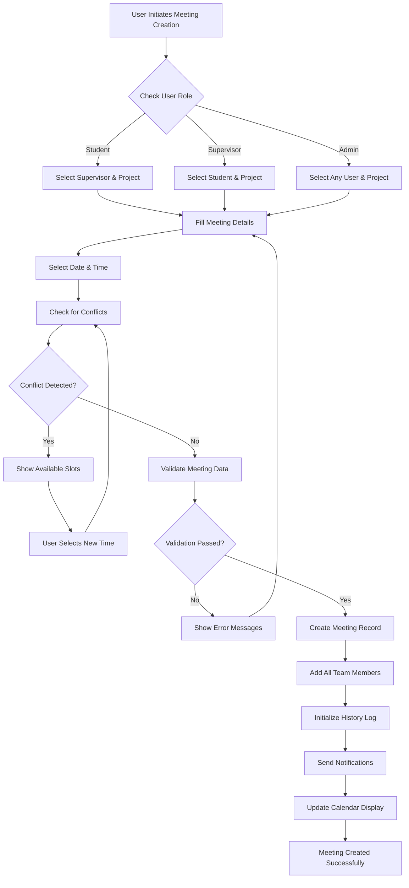

### 2. Meeting Request Workflow
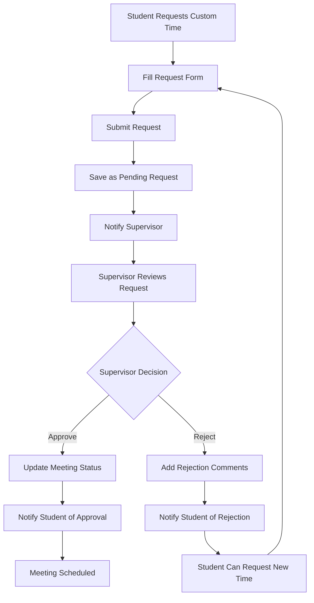

### 3. Meeting Update Workflow
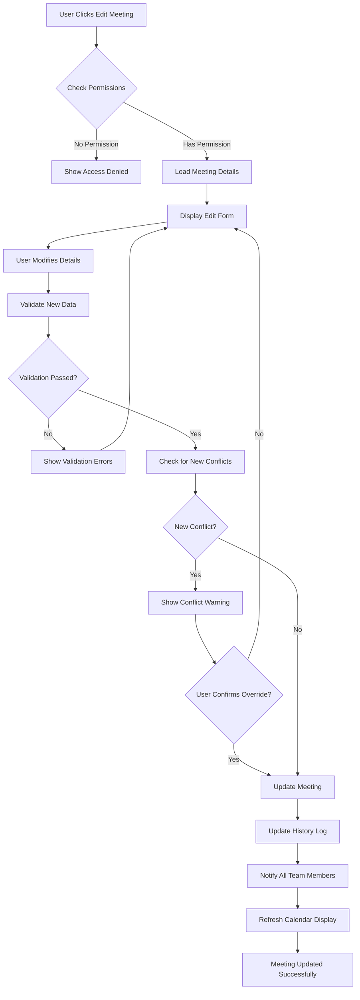

### 4. Meeting Deletion Workflow
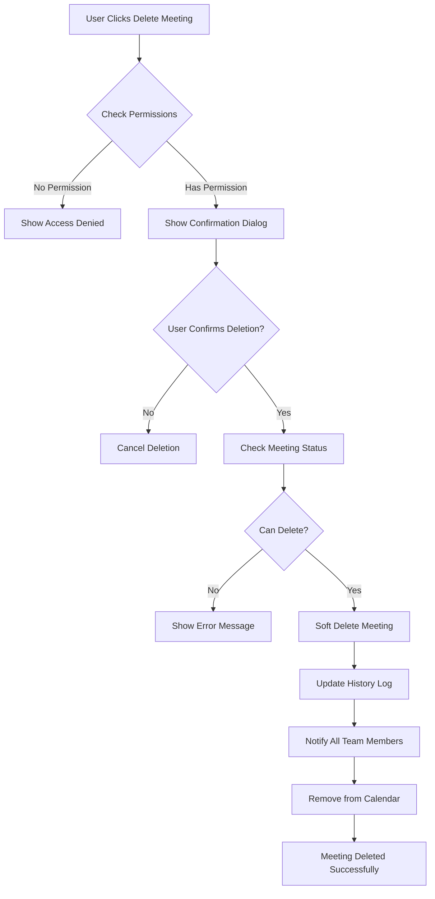

### 5. Team-Based Permission System
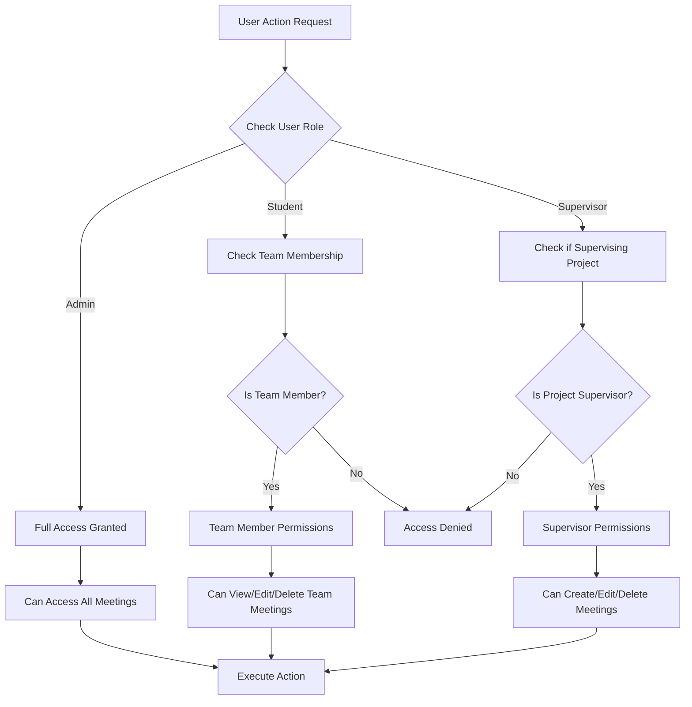

### 6. Conflict Detection System
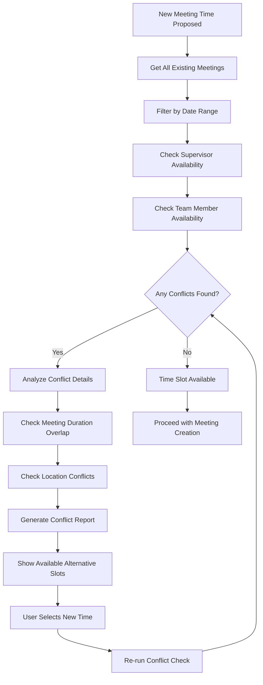

### 7. Notification System Flow
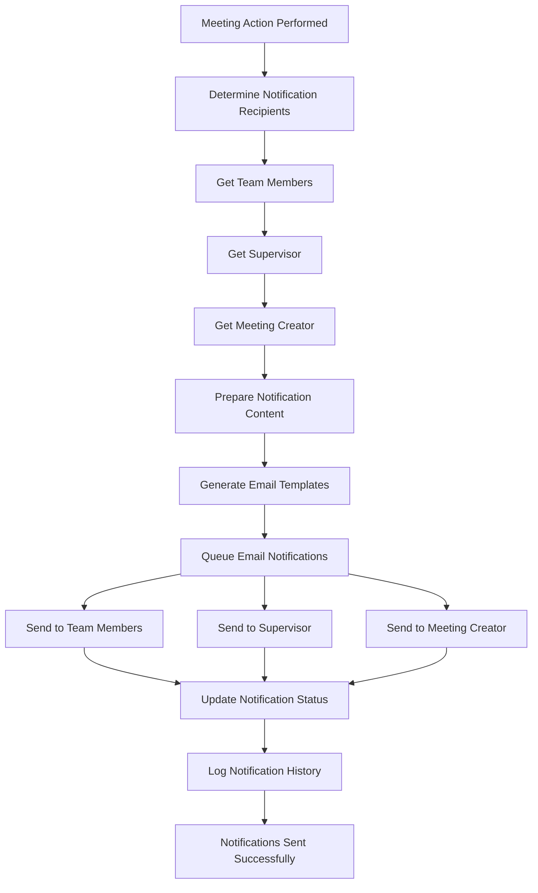

### 8. Calendar Display Logic
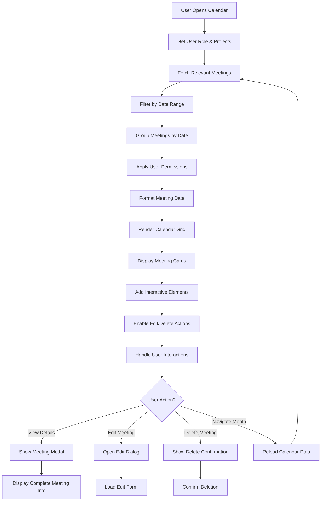

## Configuration

### Environment Variables
```bash
# Database
MONGODB_URI=mongodb://localhost:27017/project-phoenix

# JWT
JWT_SECRET=your-secret-key
JWT_EXPIRES_IN=7d

# Email (for notifications)
EMAIL_HOST=smtp.gmail.com
EMAIL_PORT=587
EMAIL_USER=your-email@gmail.com
EMAIL_PASS=your-app-password

# Server
PORT=5000
NODE_ENV=development
```

### Meeting Types Configuration
```javascript
const MEETING_TYPES = [
  { value: 'proposal', label: 'Proposal Meeting', duration: 60 },
  { value: 'mid-term', label: 'Mid-term Review', duration: 90 },
  { value: 'final', label: 'Final Defense', duration: 120 },
  { value: 'progress', label: 'Progress Update', duration: 30 },
  { value: 'other', label: 'Other', duration: 60 }
];
```

### Time Slot Configuration
```javascript
const TIME_SLOTS = {
  startHour: 9,    // 9 AM
  endHour: 17,     // 5 PM
  slotDuration: 30, // 30 minutes
  workingDays: [1, 2, 3, 4, 5] // Monday to Friday
};
```

## Troubleshooting

### Common Issues

#### 1. Meeting Conflict Detection Not Working
**Symptoms**: Meetings can be scheduled at conflicting times
**Solutions**:
- Check if `getAvailableSlots` is being called correctly
- Verify project team members are properly populated
- Ensure time zone handling is correct

#### 2. Permission Denied Errors
**Symptoms**: Users can't edit/delete meetings they should have access to
**Solutions**:
- Verify user role in JWT token
- Check team membership in project
- Ensure proper role-based access control

#### 3. Calendar Not Updating
**Symptoms**: New meetings don't appear in calendar
**Solutions**:
- Check RTK Query cache invalidation
- Verify API response format
- Ensure proper data flow from backend to frontend

#### 4. Email Notifications Not Sending
**Symptoms**: No email notifications for meeting changes
**Solutions**:
- Check email service configuration
- Verify SMTP credentials
- Check email service status

### Debug Mode
Enable debug logging by setting:
```bash
DEBUG=meeting:*
```

### Logging
The system logs all meeting operations:
```javascript
console.log('Meeting created:', meetingId);
console.log('Conflict detected:', conflictDetails);
console.log('Permission check:', { userId, role, allowed });
```

## Best Practices

### 1. Performance Optimization
- Use database indexes for frequent queries
- Implement pagination for large meeting lists
- Cache frequently accessed data
- Optimize calendar rendering

### 2. Security
- Validate all input data
- Use proper authentication/authorization
- Sanitize user inputs
- Implement rate limiting

### 3. User Experience
- Provide clear error messages
- Implement loading states
- Use optimistic updates
- Ensure responsive design

### 4. Data Integrity
- Use database transactions
- Implement proper validation
- Maintain audit trails
- Handle edge cases

## System Integration

### Integration Architecture
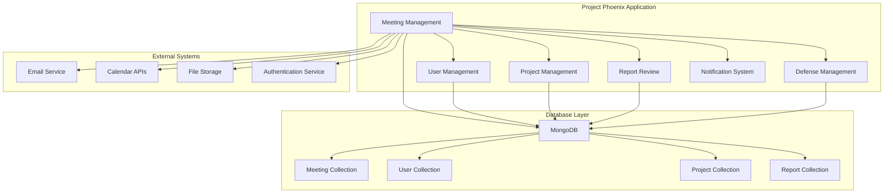

### Data Relationships
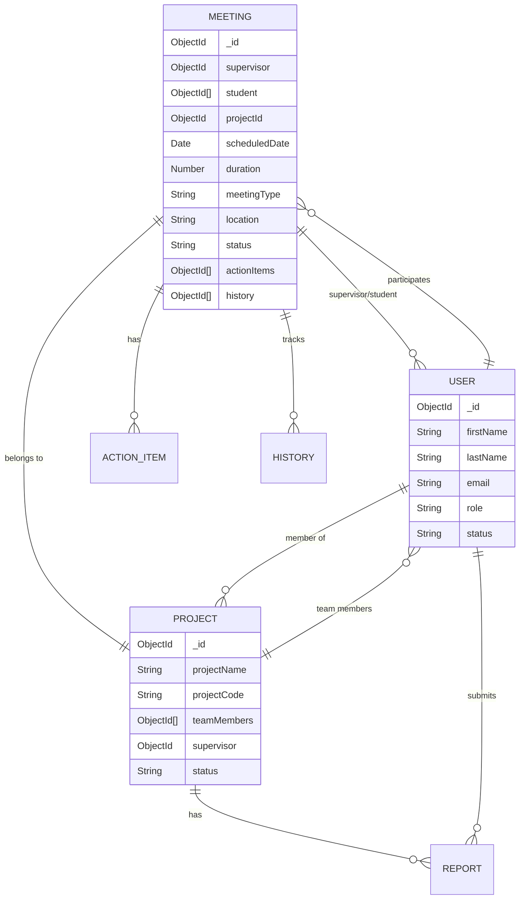

## Future Enhancements

### Planned Features
1. **Recurring Meetings**: Support for weekly/monthly recurring meetings
2. **Meeting Templates**: Pre-defined meeting structures
3. **Integration**: Calendar sync with external systems (Google Calendar, Outlook)
4. **Advanced Notifications**: SMS, push notifications
5. **Meeting Analytics**: Reports on meeting patterns and productivity
6. **Video Integration**: Built-in video conferencing
7. **Document Sharing**: Meeting-related document management
8. **Mobile App**: Native mobile application

### Technical Improvements
1. **Real-time Updates**: WebSocket integration for live updates
2. **Offline Support**: PWA capabilities for offline meeting management
3. **Advanced Search**: Full-text search across meeting content
4. **Bulk Operations**: Mass meeting management features
5. **API Versioning**: Proper API versioning strategy
6. **Performance Monitoring**: Application performance monitoring
7. **Automated Testing**: Comprehensive test coverage
8. **Documentation**: API documentation with Swagger/OpenAPI

### Integration Roadmap
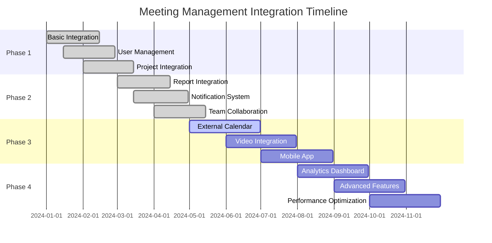

---

*This documentation is maintained and updated regularly. For questions or contributions, please contact the development team.*
